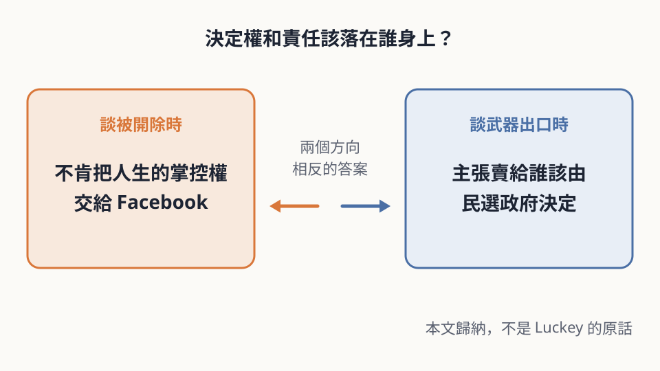

# 「賈伯斯用 iPhone 毀了一切」：Palmer Luckey 對賈伯斯傳作者談技能天花板、被開除與自主武器

*圖：抽象示意，不是影片畫面；弧線與圓點不代表任何資料，和下文技能天花板圖的曲線無關。*

> 本導讀的分析與撰稿由 AI 模型完成，不是人類分析，也沒有經過人工逐句校稿，見〈製作說明〉。

引言的中文是 AI 依 YouTube 機器字幕翻譯的譯文，可能有誤；每句直接引言附影片時間戳，可以點開對照原音。全文中譯見[全文譯本](translation-zh.html)，中英對照可用[字幕同步播放器](player.html)。

一分鐘、十分鐘、五萬小時。Palmer Luckey 用這三個數字說明科技哪裡走偏了：iPhone 這類產品一分鐘就學會、十分鐘就碰到天花板，之後就算練上五萬小時，也換不到更多。他的結論是「賈伯斯用 iPhone 毀了一切」（[09:10](https://www.youtube.com/watch?v=Wj00YlDuWXc&t=550s)），但同一段他也說「我很愛這個人」（[07:28](https://www.youtube.com/watch?v=Wj00YlDuWXc&t=448s)），還說「我們至今仍在承受他那令人驚嘆的產品設計所帶來的衝擊。」（[09:13](https://www.youtube.com/watch?v=Wj00YlDuWXc&t=553s)）**他批評的是 iPhone 帶起的設計模式，不是賈伯斯本人。**坐在對面聽這段話的，是寫過《賈伯斯傳》的 Walter Isaacson。

Oculus 是 Luckey 的第一家公司。依 Isaacson 的開場旁白，他十幾歲時在加州長堤父母家外的露營拖車裡做原型（[00:42](https://www.youtube.com/watch?v=Wj00YlDuWXc&t=42s)）；他說若不是在家自學、十四五歲就同時修高中與大學學分，就不會有 Oculus（[03:10](https://www.youtube.com/watch?v=Wj00YlDuWXc&t=190s)）。他大學輟學去做 Oculus VR；Facebook 在 2014 年 3 月宣布以總計約 20 億美元收購 Oculus（[Facebook 新聞稿](https://about.fb.com/news/2014/03/facebook-to-acquire-oculus/)），2017 年 3 月他離開 Facebook（[UploadVR](https://uploadvr.com/palmer-luckey-departs-facebook/)），同年創立國防科技公司 Anduril（[Anduril 官網摘要](https://www.anduril.com/llms.txt)）。這一集，Isaacson 從 iPhone 問起，問到賣掉 Oculus 的算盤、離開 Facebook 後為什麼不打官司，再問到 Anduril 是不是要做自主武器；最後這題 Luckey 直接說是，接著解釋他為什麼認為讓機器做殺傷決定才合乎道德。

本文把這四十四分鐘讀成兩組問題（本文歸納）：**工具該讓人好上手，還是讓人變強？決定權和責任該落在誰身上？** 第二組問題，他給過兩個方向相反的答案：談被開除時，他不肯把人生的掌控權交給 Facebook；談武器出口時，他主張賣給誰該由民選政府決定。

## 一分鐘學會、十分鐘封頂

Isaacson 先拋出自己的看法：最偉大的科技進展在於人機介面，最後可能走到 Neuralink 與植入腦中的晶片（[06:51](https://www.youtube.com/watch?v=Wj00YlDuWXc&t=411s)）。Luckey 回答：「老實說，我認為整個產業完全走錯了方向。」（[07:20](https://www.youtube.com/watch?v=Wj00YlDuWXc&t=440s)）

他說，在 iPhone 之前，大家相信科技能倍增一個人的產出，賈伯斯也深信這一點，還把電腦稱為「心靈的腳踏車」（[07:46](https://www.youtube.com/watch?v=Wj00YlDuWXc&t=466s)）。iPhone 的問題是把一切簡化到「你不到 1 分鐘就能學會使用它」（[07:56](https://www.youtube.com/watch?v=Wj00YlDuWXc&t=476s)），**「你大約花 10 分鐘就能學會發揮它的全部功能，但接著你就達到了極限天花板。」（[08:05](https://www.youtube.com/watch?v=Wj00YlDuWXc&t=485s)）**這套設計太成功，「現在每個應用程式都是 iPhone」（[08:16](https://www.youtube.com/watch?v=Wj00YlDuWXc&t=496s)），連 VR 頭戴裝置也是；這類系統「卻完全沒有為願意花 1,000 小時、1 萬小時、5 萬小時精進技藝的人留下發揮空間。」（[08:28](https://www.youtube.com/watch?v=Wj00YlDuWXc&t=508s)）

他想看到的是反方向：一種「需要數個月、也許數年的訓練才能真正精通」（[08:52](https://www.youtube.com/watch?v=Wj00YlDuWXc&t=532s)）的介面，練成之後換來超乎常人的能力；他說他對此有些想法，但沒有展開。他拿運動、舞蹈和鋼琴來比（[10:07](https://www.youtube.com/watch?v=Wj00YlDuWXc&t=607s)）：人們願意花時間練這些，卻不願意練和電腦互動的技能。至於 Neuralink 這類腦機介面，「我看到他們也在犯同樣的錯誤。」（[09:08](https://www.youtube.com/watch?v=Wj00YlDuWXc&t=548s)）

*圖：依講者說法整理的示意（07:56–08:52），曲線形狀不是量測資料，縱軸不標數值。*

Isaacson 反駁：Oculus Rift 完全直覺，「確實也是走賈伯斯的傳統」（[09:20](https://www.youtube.com/watch?v=Wj00YlDuWXc&t=560s)）。Luckey 一口承認，說這跟他的論點不矛盾，**「我只是意識到自己也是問題的一部分。」（[09:36](https://www.youtube.com/watch?v=Wj00YlDuWXc&t=576s)）**他做了入門門檻和技能天花板都極低的產品，也賣出很多台；他能體認「遵循 iPhone 模式比較容易打造出成功的產品」（[09:49](https://www.youtube.com/watch?v=Wj00YlDuWXc&t=589s)），同時仍為這對人類的影響惋惜。

## 賣給 Facebook 的那筆帳

Isaacson 問，當年為什麼選 Facebook，不選 Microsoft 或 Google。Luckey 說 2014 年的 Google 與 Microsoft，十年計畫裡沒有真正把 VR 算進去（[10:42](https://www.youtube.com/watch?v=Wj00YlDuWXc&t=642s)），Microsoft 要成功靠的是 Office 和 Windows；Facebook 沒有自己的作業系統，也不掌控硬體平台，「他們完全受制於那些真正掌控這些科技平台的人。」（[11:22](https://www.youtube.com/watch?v=Wj00YlDuWXc&t=682s)）

他轉述 Facebook 當時的說法：**賣給別人，你只是另一條業務線，沒賺錢就被拆掉；「反觀 Facebook 則需要你成功。」（[11:42](https://www.youtube.com/watch?v=Wj00YlDuWXc&t=702s)）**依他的說法，Facebook 承諾未來 10 年每年投入 10 億美元研發（[12:15](https://www.youtube.com/watch?v=Wj00YlDuWXc&t=735s)），收購公告裡沒有這一條；後來實際上「他們花了大概 700 億美元」（[12:43](https://www.youtube.com/watch?v=Wj00YlDuWXc&t=763s)），這個數字怎麼算他沒有說明。他拿 Google 對照：Google 在 Oculus 被收購後約一年半就關掉自己的 VR 計畫，幾年後重啟又砍掉（[12:56](https://www.youtube.com/watch?v=Wj00YlDuWXc&t=776s)），所以他認為 Oculus 若被 Google 買下，十之八九早就被關了。

Isaacson 把話題拉回錄影當時：Meta 剛裁掉 VR／AR 團隊 10%（[13:18](https://www.youtube.com/watch?v=Wj00YlDuWXc&t=798s)）。2026 年 1 月的報導是 Meta 裁掉 Reality Labs 約 10% 人力（[TechCrunch](https://techcrunch.com/2026/01/14/meta-to-reportedly-lay-off-10-of-reality-labs-staff/)）。Luckey 說，大部分的錢花在一般人看不到的研發，例如光學元件、相機和運算系統（[13:49](https://www.youtube.com/watch?v=Wj00YlDuWXc&t=829s)）；至於 Meta Horizon，「那是一款很糟的產品。」（[14:00](https://www.youtube.com/watch?v=Wj00YlDuWXc&t=840s)）他也說自己正與 Meta 合作，認為對方不介意他這麼講；Anduril 與 Meta 在 2025 年 5 月宣布合作開發軍用 XR 產品（[Anduril 公告](https://www.anduril.com/news/anduril-and-meta-team-up-to-transform-xr-for-the-american-military)）。

他不認為裁員代表放棄 VR：剩下的 90%「確確實實比第二大的 VR 團隊還要大上 10 倍」（[14:29](https://www.youtube.com/watch?v=Wj00YlDuWXc&t=869s)）；被裁的職位集中在少數領域，例如 Meta 決定不再做和其他開發者競爭的第一方遊戲（[14:56](https://www.youtube.com/watch?v=Wj00YlDuWXc&t=896s)）。他說他為丟了生計的人難過，但認為這對 VR 生態系是對的決定。他替開發者說出顧慮：平台自己也做遊戲，就會把自家遊戲擺在商店最顯眼的位置、投放所有廣告、用補貼價競爭，「在這種競爭下我要怎麼賺錢？」（[15:58](https://www.youtube.com/watch?v=Wj00YlDuWXc&t=958s)）

## 為什麼不打官司

Isaacson 問他是否有點希望自己還留在 Meta，Luckey 說有點希望（[16:09](https://www.youtube.com/watch?v=Wj00YlDuWXc&t=969s)），但他認為在 Anduril 造成的影響更大；就算讓他回 Oculus，也解決不了底層的問題：「灣區的大多數人在政治立場上都與我非常對立，他們討厭我，也不想跟我共事。」（[16:31](https://www.youtube.com/watch?v=Wj00YlDuWXc&t=991s)）他真正希望的是整個世界不同、時光能倒流。Isaacson 插話說科技圈已經變了，他、Peter Thiel、David Sacks 都在其中；Luckey 也認了：「所以我的抱怨有點過時了。」（[17:04](https://www.youtube.com/watch?v=Wj00YlDuWXc&t=1024s)）

接著 Isaacson 直接說：「你被開除基本上是因為你向一個支持川普的政治行動委員會（PAC）捐贈了 9,000 或 1 萬美元。」（[17:27](https://www.youtube.com/watch?v=Wj00YlDuWXc&t=1047s)）他還說，對方宣稱與政治無關，那不是實情。**這是主持人的斷言，Luckey 沒有接這一句**，他回答的是下一個問題：是否希望當時反擊、為自己的權利而戰（[17:39](https://www.youtube.com/watch?v=Wj00YlDuWXc&t=1059s)）。Facebook 一方的說法見〈對照公開資料〉。

他說：「真實的答案是肯定的。」（[17:43](https://www.youtube.com/watch?v=Wj00YlDuWXc&t=1063s)）當時他才 24 歲，對這些事完全沒有經驗，他想他大概本該更奮力反抗（[17:50](https://www.youtube.com/watch?v=Wj00YlDuWXc&t=1070s)）。

但他花更多時間解釋為什麼沒有反抗。打官司打不回公司，「你不可能透過提告來讓他們任命你當執行長，對吧？」（[18:07](https://www.youtube.com/watch?v=Wj00YlDuWXc&t=1087s)）能拿的只有錢，還得證明對方毀了你募資和找人的能力；**「為了打贏這些訴訟，你基本上必須把自己的生活轉變成一個全職的職業受害者。」（[18:37](https://www.youtube.com/watch?v=Wj00YlDuWXc&t=1117s)）**

接下來這段被節目剪進了片頭預告（正片原處從 [18:45](https://www.youtube.com/watch?v=Wj00YlDuWXc&t=1125s) 開始）。

> 重點：他說，花五年當職業受害者，基本上等於把支配自己的權力交給對方（[18:55](https://www.youtube.com/watch?v=Wj00YlDuWXc&t=1135s)）。

他說另一條路是創立新公司，「證明我不是曇花一現，證明我不是別人口中的那個笨蛋」（[19:07](https://www.youtube.com/watch?v=Wj00YlDuWXc&t=1147s)）。他認為事後看來他選對了；理想狀況是既為正義而戰、又創立 Anduril，「但很難想像我能同時有效地兼顧兩者」（[19:24](https://www.youtube.com/watch?v=Wj00YlDuWXc&t=1164s)）。

Isaacson 追問，能不能像 Elon Musk 那樣兩邊同時經營。Luckey 說他不知道還有誰能像 Musk 那樣做到，他當然不認為自己做得到（[20:20](https://www.youtube.com/watch?v=Wj00YlDuWXc&t=1220s)）。他也有幾個小副業，例如 ModRetro 這個線上社群現在做的復古遊戲機，但「Anduril 佔據了我 99% 的時間。」（[21:03](https://www.youtube.com/watch?v=Wj00YlDuWXc&t=1263s)）

被開除的經過，他在 2026 年 11 月另一場舞台訪談自己談了：捐款之後先被停職、接著被開除，他說考績很好（見[Palmer Luckey 談 War 2.0](https://lushinshang.github.io/luckey-war-2-0/)）。

## 從出資人變成創辦人

Isaacson 問他怎麼走上國防這條路。Luckey 說美國在國防科技上落後，政府給大型國防公司的誘因，「顯然沒有促使他們去投資這類技術」（[21:36](https://www.youtube.com/watch?v=Wj00YlDuWXc&t=1296s)）；同時大型科技公司拒絕與國家安全體系合作，他說美國史上從未有過這種情況（[21:51](https://www.youtube.com/watch?v=Wj00YlDuWXc&t=1311s)）。

他說一開始只想出資給其他國防公司（[22:33](https://www.youtube.com/watch?v=Wj00YlDuWXc&t=1353s)），因此認識了 Founders Fund 的 Trae Stephens，對方的任務是找出下一個 SpaceX 或 Palantir（[22:41](https://www.youtube.com/watch?v=Wj00YlDuWXc&t=1361s)）。Anduril 官網列 Stephens 為共同創辦人、執行董事長，也是 Founders Fund 合夥人（[Anduril 官網摘要](https://www.anduril.com/llms.txt)）。Luckey 說，「我想他已經與大約 2,000 家不同的公司會面過」（[22:56](https://www.youtube.com/watch?v=Wj00YlDuWXc&t=1376s)），結果一家都沒投；這個數字只有他的說法。他的解釋是，這些團隊沒有能和洛克希德、Northrop、波音正面交鋒的那一套能力，沒辦法從小裝置供應商變成「下一代國防主承包商」（[23:22](https://www.youtube.com/watch?v=Wj00YlDuWXc&t=1402s)）。

他說被開除後，Trae 是他最先打電話的人之一，他告訴對方「我認為我們需要自己創立一家」（[23:37](https://www.youtube.com/watch?v=Wj00YlDuWXc&t=1417s)）。依他的轉述，Trae 回他：你不是忙著 Facebook 的事嗎？他半開玩笑地答，這是他願意付出的犧牲。他說公司從一開始的宗旨，就是「透過每年賺取數百億美元，來為納稅人每年節省數千億美元」（[23:47](https://www.youtube.com/watch?v=Wj00YlDuWXc&t=1427s)）。

被問到有哪種大型系統能做得比波音和洛克希德好，他說不想點名批評別人，但舉了空軍的協同作戰飛機（Collaborative Combat Aircraft，CCA）計畫，並強調評判的是美國空軍（[24:16](https://www.youtube.com/watch?v=Wj00YlDuWXc&t=1456s)）。他說 Anduril 的無人機 Fury（空軍編號 FQ-44）在 CCA Increment 1 合約「擊敗了 Northrop、波音和洛克希德」（[24:32](https://www.youtube.com/watch?v=Wj00YlDuWXc&t=1472s)），也預期之後會以固定節奏贏得重大計畫。Increment 1 指 CCA 第一批投入作戰的無人機。他沒提另一家同時入選的公司，見〈對照公開資料〉。

Isaacson 把 Palantir 的 Alex Karp、SpaceX 的 Musk 和 Anduril 歸成同一種模式：不等政府委託，先做出產品再拿去推。Luckey 同意，但說有時也和客戶一起開發、由客戶分攤部分成本（[25:30](https://www.youtube.com/watch?v=Wj00YlDuWXc&t=1530s)）；**「總體而言，Anduril 是一家產品公司，而不是承包商。」（[25:39](https://www.youtube.com/watch?v=Wj00YlDuWXc&t=1539s)）**他說在政府給一毛錢之前，公司就已經投入數十億美元（[25:43](https://www.youtube.com/watch?v=Wj00YlDuWXc&t=1543s)），有的飛機開發了 5 年，現在才第一次從政府拿到錢（[25:51](https://www.youtube.com/watch?v=Wj00YlDuWXc&t=1551s)）；他認為這樣比較健康，跌倒會擦破膝蓋，人才會保持警覺（[26:03](https://www.youtube.com/watch?v=Wj00YlDuWXc&t=1563s)）。

這些產品背後是軟體平台 Lattice。Luckey 說「它算是 AI 大腦」（[28:21](https://www.youtube.com/watch?v=Wj00YlDuWXc&t=1701s)），驅動飛彈、潛艦、戰鬥機、感測塔等 25 種以上的產品，全部串在一起後，每個感測器都是其他系統的眼睛（[28:35](https://www.youtube.com/watch?v=Wj00YlDuWXc&t=1715s)）。Anduril 官網對其中 Lattice for C2 的描述，是整合數千個感測器與作用載具（effectors）、加快殺傷鏈的 AI 戰場管理平台（[Anduril 官網摘要](https://www.anduril.com/llms.txt)）。他從投資報酬率解釋：**1 美元花在機翼，只有那一架飛機變好，花在 Lattice，所有用它的東西都變好**；他說投入 Lattice 的人數和所有硬體產品加起來一樣多（[29:04](https://www.youtube.com/watch?v=Wj00YlDuWXc&t=1744s)）。

## 自主武器與戰爭的未來

### 有立場，但不自己挑客戶

Isaacson 說 Anduril 這名字出自《魔戒》裡代表正義力量的寶劍（[26:09](https://www.youtube.com/watch?v=Wj00YlDuWXc&t=1569s)），問他是否帶著道德使命。Luckey 說是，Anduril「不是一家政治中立、道德中立或倫理中立的公司」（[26:25](https://www.youtube.com/watch?v=Wj00YlDuWXc&t=1585s)），想和捍衛言論自由、自治等權利的國家合作。

但說到底，公司「某種程度上是受制於美國政府的」（[26:57](https://www.youtube.com/watch?v=Wj00YlDuWXc&t=1617s)）：政府不准賣的國家他不能賣，政府要合作的盟友他也得合作。這類決策的責任，已經交給「我們所有人都能要求為那些決策負責的民選官員」（[27:26](https://www.youtube.com/watch?v=Wj00YlDuWXc&t=1646s)）。有人問他是否該自己挑國家幫，他的回應是：**「你不會想生活在一個由少數幾位武器企業主管實質控制美國外交政策的世界裡。」（[27:38](https://www.youtube.com/watch?v=Wj00YlDuWXc&t=1658s)）**他說讓公司負起責任的唯一方法，是讓它成為政府政策的延伸；否則洛克希德馬丁的執行長可能比美國總統還有權力，「而這大概不是一件好事」（[28:03](https://www.youtube.com/watch?v=Wj00YlDuWXc&t=1683s)）。

*圖：本文歸納，不是 Luckey 的原話；一個答案出自前面的〈為什麼不打官司〉，另一個就是本節。*

### 校車、地雷和那顆按鈕

Isaacson 接著問，目的是不是要製造自主武器，Luckey 只回一句：「是的。」（[29:33](https://www.youtube.com/watch?v=Wj00YlDuWXc&t=1773s)）那讓無人機或自主系統在沒有人在迴路中的情況下做擊殺決定，有沒有問題？他說：**「我認為這是唯一理性且符合道德的結果或決定。」（[29:46](https://www.youtube.com/watch?v=Wj00YlDuWXc&t=1786s)）**他的理由是生死決定太重要，不能不動用手上最強的科技；他說這稱不上 AI 之爭，要問的是你要不要用「能夠可衡量且可證明帶來最低附帶損害的最佳技術」（[30:09](https://www.youtube.com/watch?v=Wj00YlDuWXc&t=1809s)）。

**他舉的例子是一枚自主地雷，能分辨俄羅斯坦克和一輛載滿孩子的校車（[30:31](https://www.youtube.com/watch?v=Wj00YlDuWXc&t=1831s)）**。他說世上有人認真主張，寧可用會炸掉校車的笨地雷，只要決定生死的不是機器人就好，「我實在無法苟同這一點。」（[30:49](https://www.youtube.com/watch?v=Wj00YlDuWXc&t=1849s)）會有人問，萬一演算法犯了這類錯怎麼辦；他的回答是去規範它：管演算法的品質、輸出和使用方式，並在使用或濫用時追究人的責任（[31:00](https://www.youtube.com/watch?v=Wj00YlDuWXc&t=1860s)）。他說聯合國有人呼籲禁止致命自主武器系統（LAWS），口號聽起來很好，實際結果卻是承諾只製造「無法分辨真正作戰人員與平民的笨武器」（[31:27](https://www.youtube.com/watch?v=Wj00YlDuWXc&t=1887s)）；聯合國秘書長與紅十字國際委員會主席的公開主張，是以具約束力的規範對自主武器同時訂出禁止與限制條款，兩人在錄影之後的 2026 年 8 月 25 日再次呼籲（[聯合國日內瓦辦事處](https://ungeneva.org/en/news-media/press-release/2026/08/renewed-call-united-nations-secretary-general-and-president)）。

Isaacson 反問，他剛才批評的正是美軍的軍事準則（[31:40](https://www.youtube.com/watch?v=Wj00YlDuWXc&t=1900s)）：在 Creech 空軍基地，無人機飛遍中東，但必須有人坐在螢幕前、在迴路中。Luckey 認為，那套準則受限於他們現有技術的極限（[31:59](https://www.youtube.com/watch?v=Wj00YlDuWXc&t=1919s)），就目前而言是很好的準則：過去機器做決定的品質太粗糙，全面交給機器會是很糟的主意。

他另外提出一個角度：自主性在許多方面是在消除失效模式（[32:22](https://www.youtube.com/watch?v=Wj00YlDuWXc&t=1942s)）。他提到有人入侵未加密的 Predator 視訊串流；2009 年的報導指出，伊拉克與阿富汗的武裝分子截取過 Predator 無人機的即時影像，但沒有證據顯示他們能干擾訊號（[CBS／AP](https://www.cbsnews.com/news/insurgents-intercepted-drone-spy-videos)）。他說，不帶無線電的自主系統就沒有這類網路漏洞；反過來，「必須有人按下最終擊殺決定按鈕」的要求，也可能讓每一件武器都能被敵人劫持（[32:42](https://www.youtube.com/watch?v=Wj00YlDuWXc&t=1962s)）。

他也承認 Isaacson 說的大致上沒錯（[32:59](https://www.youtube.com/watch?v=Wj00YlDuWXc&t=1979s)），Predator 確實要有人在迴路中按按鈕。但美國自越戰以來就在用反輻射飛彈（[33:06](https://www.youtube.com/watch?v=Wj00YlDuWXc&t=1986s)）：飛彈射到視距外，自己找特定的射頻訊號撞上去；他說美國已經有很多武器系統自行做擊殺決定，只是那些決定非常特定。

Isaacson 補充，地雷完全是自主的（[33:30](https://www.youtube.com/watch?v=Wj00YlDuWXc&t=2010s)）。Luckey 說他幾年前做過演講，主張自主武器已有數千年歷史：地雷主要依壓力板上的重量或磁性特徵挑目標；更早還有陷坑，人走過去沒事，馬會踩破掉下去，抓的是騎在馬上的高階軍官（[34:13](https://www.youtube.com/watch?v=Wj00YlDuWXc&t=2053s)）。「我認為用 AI 來做這件事，跟利用陷坑上竹子的厚度來做，實際上並沒有本質上的不同。」（[34:36](https://www.youtube.com/watch?v=Wj00YlDuWXc&t=2076s)）

| 例子 | 依什麼挑目標（講者說法） |
|---|---|
| 陷坑 | 上面竹子的厚度：人走過去沒事，馬會踩破掉下去 |
| 地雷 | 壓力板上的重量或目標的磁性特徵 |
| 反輻射飛彈（美國自越戰起使用） | 特定的射頻訊號 |
| 自主地雷（他的主張，不是現況） | 分辨俄羅斯坦克和載滿孩子的校車 |

*表：依講者說法整理。前三種是他說已經在自行挑目標的武器，最後一列是他主張的方向。*

> 重點：他的結論是「關鍵在於必須有人對武力的使用負責」（[34:46](https://www.youtube.com/watch?v=Wj00YlDuWXc&t=2086s)）。

陷坑挖在錯誤的街道中央，挖的人就要為後果負責，不能說自己不是故意的；「我想 AI 武器也是一樣的。」（[35:10](https://www.youtube.com/watch?v=Wj00YlDuWXc&t=2110s)）

### 少死人的戰爭，沒人記功的嚇阻

Isaacson 問，能不能想像未來的戰爭幾乎全由機器打、很少有人死？Luckey 先預告這個論點很難不被往最壞處解讀，然後說「我們基本上已經生活在那種情況的早期版本中了」（[35:39](https://www.youtube.com/watch?v=Wj00YlDuWXc&t=2139s)）。他的依據是：過去差不多 30 年，一般來說死於戰爭的人少得多（[35:53](https://www.youtube.com/watch?v=Wj00YlDuWXc&t=2153s)）；精準導引武器讓二戰時的轟炸做法在今天會被視為戰爭罪；而當代人記憶中就有死亡數千萬人的戰爭。他說「所以我認為，我們在這個尺度上其實已經往下走了大約 90%」（[36:37](https://www.youtube.com/watch?v=Wj00YlDuWXc&t=2197s)），剩下的是在邊際上爭論；他認為以後多數傷亡會是機器人、系統和硬體，而非血肉之軀（[37:13](https://www.youtube.com/watch?v=Wj00YlDuWXc&t=2233s)），他說已經走到九成，這大概是一件好事（[37:26](https://www.youtube.com/watch?v=Wj00YlDuWXc&t=2246s)）。這裡的 90% 是他的比喻說法。

Isaacson 再問，你們的技術最後遏阻的戰爭，會不會比引發的多？Luckey 說那當然是期望，但**「Anduril 越成功，我們獲得的功勞反而越少」（[37:37](https://www.youtube.com/watch?v=Wj00YlDuWXc&t=2257s)）**。假設 20 年後都沒有和中國開戰，他說那是許多公司、許多國家一起促成的，大家卻會以為那是自然狀態，想不到那是一座精心設計的花園（[38:19](https://www.youtube.com/watch?v=Wj00YlDuWXc&t=2299s)）。反過來，如果真的開戰、Anduril 的系統天天派上用場，**「但到了那個地步，我們其實就已經輸了」（[38:41](https://www.youtube.com/watch?v=Wj00YlDuWXc&t=2321s)），因為打仗就代表花園沒有建好**。

## 他最怕的 AI 用途

Isaacson 轉述系列另一位來賓李飛飛的話：AI 是人們才剛開始理解的強大工具，也是一份深遠的責任（[38:56](https://www.youtube.com/watch?v=Wj00YlDuWXc&t=2336s)）；這句話的原始出處節目沒有交代。他問 Luckey，現在該釐清哪些責任。

Luckey 先表明：「我不是一個支持審查的人。」（[39:18](https://www.youtube.com/watch?v=Wj00YlDuWXc&t=2358s)）他也不喜歡限制 AI 不能做某些事。**但如果只能挑一個領域來管，他選的是用 AI 製造生物與化學武器（[39:32](https://www.youtube.com/watch?v=Wj00YlDuWXc&t=2372s)）**。他說很多知識過去埋在學術文獻裡，要有一定門檻才勉強看得懂，AI 讓人能在「進行極其可怕的事情的鏈條上走得更遠」（[39:53](https://www.youtube.com/watch?v=Wj00YlDuWXc&t=2393s)）。

他描述一種他說已經存在的做法（他沒有點名是哪些實驗室）：有些做新藥研發的實驗室，由 AI 告訴他們該做哪些實驗、混哪些化合物（[40:02](https://www.youtube.com/watch?v=Wj00YlDuWXc&t=2402s)），現場只需要照操作說明做事、把結果回饋給 AI 的技術人員，「他們基本上是把人當作血肉機器人來幫他們做所有的事。」（[40:27](https://www.youtube.com/watch?v=Wj00YlDuWXc&t=2427s)）他預測，離某個人能在實驗室人員不知情、機器也沒察覺的情況下造出可怕的生物武器，已經不遠了（[40:30](https://www.youtube.com/watch?v=Wj00YlDuWXc&t=2430s)）。

他認為有很強的理由從資料下手：移除某些資料，或刻意竄改讓它失效，只有獲准的機構能取得（[40:44](https://www.youtube.com/watch?v=Wj00YlDuWXc&t=2444s)）。有人說這些工具也能用來研發藥物，他同意，代價可能是青少年不再能不隸屬任何實驗室、自己在車庫裡研發出新藥（[41:10](https://www.youtube.com/watch?v=Wj00YlDuWXc&t=2470s)），「而那是我願意承受的損失」（[41:22](https://www.youtube.com/watch?v=Wj00YlDuWXc&t=2482s)），條件是這能讓人無法設計出專門依族裔、種族消滅人類的生物武器。他把範圍收得很窄：如果要對 AI 課予責任，應該聚焦在「能夠自我複製、並在資料中心以外的真實世界中存活的事物」（[41:38](https://www.youtube.com/watch?v=Wj00YlDuWXc&t=2498s)）。

把這段和前面的武器論證並排，可以看出他畫線的位置（本文歸納）：對自主武器，他反對禁止，主張管品質、追責任；對生物武器，他認為有理由從源頭限制資料，連車庫裡做新藥的可能性一起犧牲。**分界是他提的那個條件：會自我複製、能在資料中心以外存活。**

## 千元汽車與海上城市

最後一題，Isaacson 讓他選兩件未來想做的酷事。第一件是發電、製造、加工與回收的垂直整合，他說會讓許多商品便宜到荒謬：紡織業機械化之後，布料比過去便宜約 1,000 倍（[42:23](https://www.youtube.com/watch?v=Wj00YlDuWXc&t=2543s)），同樣的事會發生在汽車和消費電子上；他認為有生之年就能看到 1,000 美元的車，通膨怎麼調整隨你（[42:54](https://www.youtube.com/watch?v=Wj00YlDuWXc&t=2574s)）。第二件是到海洋定居，他認為材料科學的進展會讓海上的巨型結構撐上數千年、不需要重大維護（[43:38](https://www.youtube.com/watch?v=Wj00YlDuWXc&t=2618s)）。

Isaacson 說，這話出自讀過凡爾納的小孩（[43:52](https://www.youtube.com/watch?v=Wj00YlDuWXc&t=2632s)）。訪談前段 Luckey 說過，他喜歡專注於科技本身的科幻，例如《海底兩萬里》，書裡連續十幾頁都在寫鸚鵡螺號的電池技術（[05:10](https://www.youtube.com/watch?v=Wj00YlDuWXc&t=310s)）。他收尾時說，人們最後做出來的，往往就是科幻作家擺在眼前的未來，**「所以我不敢說自己曾想出過任何比我讀過的科幻小說家更好的點子」（[44:06](https://www.youtube.com/watch?v=Wj00YlDuWXc&t=2646s)）**；他相信海上家園（seasteading）會再回來（[44:19](https://www.youtube.com/watch?v=Wj00YlDuWXc&t=2659s)）。

## 對照公開資料

這集錄於 2026 年 2 月 10 日，11 月 17 日上架（[節目音訊頁](https://omny.fm/shows/the-builders/palmer-luckey-steve-jobs-ruined-everything-with-the-iphone)）。整場只有 Luckey 一位受訪者，他是 Anduril 創辦人，談的是自己的公司與政治立場；Facebook／Meta 和主張禁止自主武器的一方都不在場。下面兩項需要補上公開資料。

- **CCA 合約**：Luckey 說 Fury 在 CCA Increment 1 擊敗 Northrop、波音與洛克希德，這和報導一致：空軍第一階段選了包括這三家在內的五家，2024 年從中選出 Anduril 與 General Atomics 兩家進入下一階段，**所以勝出的不只 Anduril**。他在錄影時說的這份合約，也還不是量產合約；量產合約在錄影之後的 2026 年 6 月 17 日才發給這兩家（[DefenseScoop](https://defensescoop.com/2026/06/17/air-force-picks-anduril-general-atomics-to-build-first-operational-cca-drones/)）。
- **被開除的原因**：Isaacson 斷言是政治捐款，並說對方的否認不是實情；Luckey 在這場沒有直接回應。Oculus 發言人在 2017 年表示他的離開與政治觀點無關（[CNBC 轉載《紐約時報》](https://www.cnbc.com/2017/06/04/oculus-founder-plots-a-comeback-with-a-virtual-border-wall.html)）；2018 年《華爾街日報》依內部郵件報導，他曾被要求為捐款道歉並表態支持自由意志黨候選人 Gary Johnson（[SiliconANGLE 轉述](https://siliconangle.com/2018/11/11/report-facebook-pushed-oculus-founder-palmer-luckey-political-views/)，二手）。

## 重點結論與實際啟示

拿 Luckey 的技能天花板說法，可以問自己在用、在做的工具：**一分鐘學會之後，再投入一千小時還能多換到什麼？**他也承認照 iPhone 模式做比較容易成功，他自己的 Oculus 就是一例。

同一位講者的其他導讀：在另一場舞台訪談談停電、衛星網與核試驗，見[Palmer Luckey 談 War 2.0](https://lushinshang.github.io/luckey-war-2-0/)；談 BlueChip 美國製筆電，見[九成來自美國與盟友，面板還在海外](https://lushinshang.github.io/luckey-qualcomm-american-laptop/)。同一個節目的另一集見[阿莫迪兄妹的《The Builders》導讀](https://lushinshang.github.io/amodei_siblings_builders_2026/)。

## 製作說明：這篇導讀由 AI 模型完成

本導讀的分析與撰稿由 AI 模型完成，不是人類分析，也沒有經過人工逐句校稿。分工如下：逐句中文翻譯由 agy 的 gemini-3.8-flash-medium 完成，再由 Claude Opus 5.5 讀完全部 524 句中英對照，實際變動其中 79 句（含標點正規化 4 句）；存疑處的聽音校對用 agy 的 gemini-3.8-flash-high，聆聽的片段涵蓋約 107 句，但實際逐字核對的句數較少，依聽音結果改寫中文的有 2 句；研究查證與撰稿由 Claude Opus 5.5 完成。Claude Opus 5.5 依審稿 A、B 的意見修稿，並由審稿 C 終審。最後再由 Claude Opus 5.5 依總編輯準則潤稿並標示重點。

整體流程由 Claude Sonnet 5.5 統籌派工與合併審稿意見。獨立審稿三路：事實審稿與終審用 Claude Opus 5.5，事實審稿另就帳本中已確認與部分確認的 15 條主張回官方或原始頁面做了第二方核對；編輯審稿用 Claude Sonnet。本文的圖由 Claude Opus 5.5 以 SVG 與動態 SVG 繪製，未使用 AI 生圖；封面是抽象示意圖，兩個答案的對照圖是本文歸納，技能天花板圖與表是本文對講者說法的整理示意，都不是影片畫面。封面與技能天花板圖有動態效果，系統開啟減少動態效果的設定時會停在靜態畫面。

字幕是 YouTube 機器字幕，沒有說話者標記，說話者依字幕的換人標記與上下文判斷。依聽音改寫的句子與聽音仍無法確認的句子，本文只轉述、不當直接引言；524 句中至少約 417 句不在任何聽音片段內，沒有對照原音。Trae Stephens、Chris Dycus、David Sacks、李飛飛等人名在字幕中被聽錯，中文依公開資料的拼法寫。引言的中文是翻譯，不是講者原話，可能有誤。重要事實附官方或媒體來源連結，只有講者說法的內容標為他的說法，二手來源在文中標明。

完整中文譯本見[全文譯本](translation-zh.html)，中英對照可用[字幕同步播放器](player.html)。

## 來源清單

- Palmer Luckey: How Steve Jobs Ruined Everything, the $2B Oculus Sale & Getting Fired From Facebook，The Builders with Walter Isaacson 頻道，2026-11-17 上傳（說明欄註明 2026-02-10 錄影），第一手：[https://www.youtube.com/watch?v=Wj00YlDuWXc](https://www.youtube.com/watch?v=Wj00YlDuWXc)
- Palmer Luckey: “Steve Jobs Ruined Everything with the iPhone”（節目音訊頁），The Builders／Omny，2026-11-17，官方（節目）：[https://omny.fm/shows/the-builders/palmer-luckey-steve-jobs-ruined-everything-with-the-iphone](https://omny.fm/shows/the-builders/palmer-luckey-steve-jobs-ruined-everything-with-the-iphone)
- Facebook to Acquire Oculus，Meta Newsroom，2014-03-25，官方：[https://about.fb.com/news/2014/03/facebook-to-acquire-oculus/](https://about.fb.com/news/2014/03/facebook-to-acquire-oculus/)
- Anduril 官網網站摘要（領導人與 Lattice 介紹），Anduril Industries，頁面未載日期（2026-11-22 讀取），官方：[https://www.anduril.com/llms.txt](https://www.anduril.com/llms.txt)
- Anduril and Meta Team Up to Transform XR for the American Military，Anduril Industries，2025-05-29，官方：[https://www.anduril.com/news/anduril-and-meta-team-up-to-transform-xr-for-the-american-military](https://www.anduril.com/news/anduril-and-meta-team-up-to-transform-xr-for-the-american-military)
- Renewed Call from the United Nations Secretary-General and the President of the International Committee of the Red Cross to Adopt Rules on Autonomous Weapon Systems，United Nations Office at Geneva，2026-08-25，官方：[https://ungeneva.org/en/news-media/press-release/2026/08/renewed-call-united-nations-secretary-general-and-president](https://ungeneva.org/en/news-media/press-release/2026/08/renewed-call-united-nations-secretary-general-and-president)
- Air Force picks Anduril, General Atomics to build first operational CCA drones，DefenseScoop，2026-06-17，二手（國防專業媒體）：[https://defensescoop.com/2026/06/17/air-force-picks-anduril-general-atomics-to-build-first-operational-cca-drones/](https://defensescoop.com/2026/06/17/air-force-picks-anduril-general-atomics-to-build-first-operational-cca-drones/)
- Oculus Co-Founder and Rift Creator Palmer Luckey Departs Facebook，UploadVR，2017-03-30，二手：[https://uploadvr.com/palmer-luckey-departs-facebook/](https://uploadvr.com/palmer-luckey-departs-facebook/)
- Oculus founder plots a comeback with a virtual border wall（轉載《紐約時報》），CNBC，2017-06-04，二手：[https://www.cnbc.com/2017/06/04/oculus-founder-plots-a-comeback-with-a-virtual-border-wall.html](https://www.cnbc.com/2017/06/04/oculus-founder-plots-a-comeback-with-a-virtual-border-wall.html)
- Report: Facebook pushed out Oculus founder Palmer Luckey for his political views（轉述《華爾街日報》報導），SiliconANGLE，2018-11-11，二手：[https://siliconangle.com/2018/11/11/report-facebook-pushed-oculus-founder-palmer-luckey-political-views/](https://siliconangle.com/2018/11/11/report-facebook-pushed-oculus-founder-palmer-luckey-political-views/)
- Meta to reportedly lay off 10% of Reality Labs staff，TechCrunch，2026-01-14，二手：[https://techcrunch.com/2026/01/14/meta-to-reportedly-lay-off-10-of-reality-labs-staff/](https://techcrunch.com/2026/01/14/meta-to-reportedly-lay-off-10-of-reality-labs-staff/)
- Insurgents Intercepted Drone Spy Videos，CBS News（AP），2009-12-17，二手：[https://www.cbsnews.com/news/insurgents-intercepted-drone-spy-videos](https://www.cbsnews.com/news/insurgents-intercepted-drone-spy-videos)
